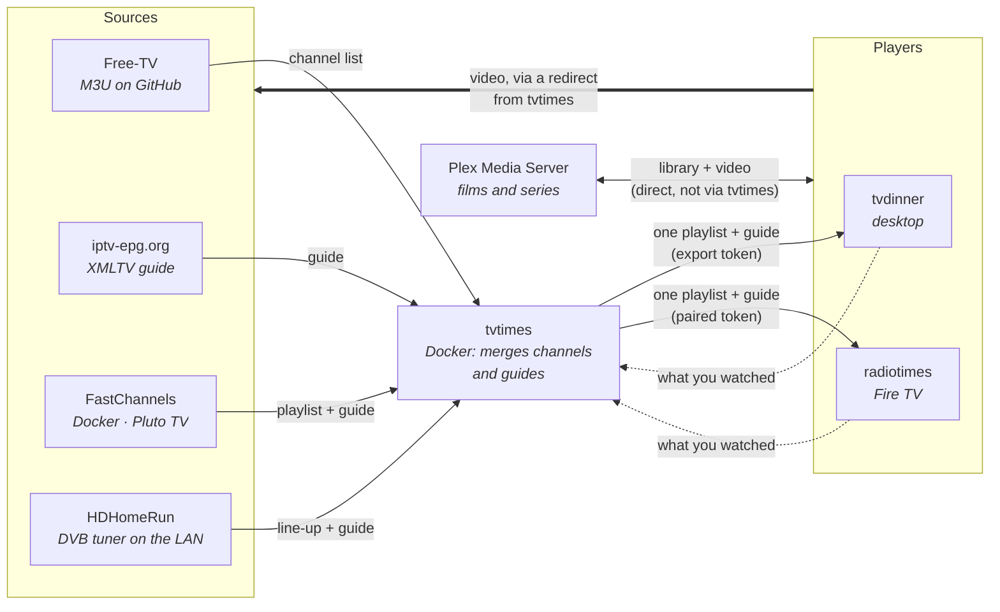
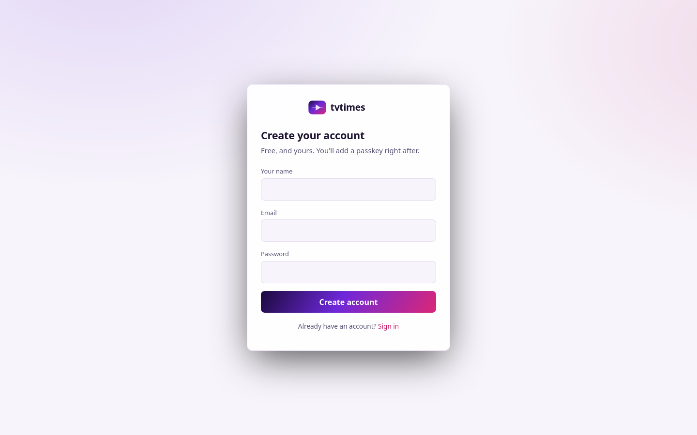
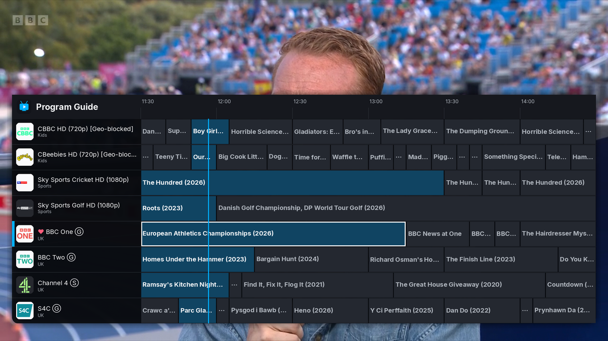
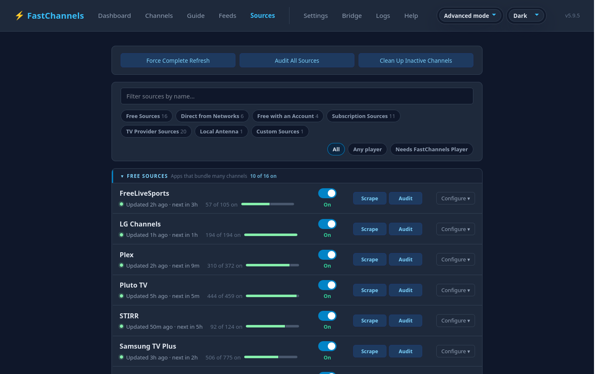
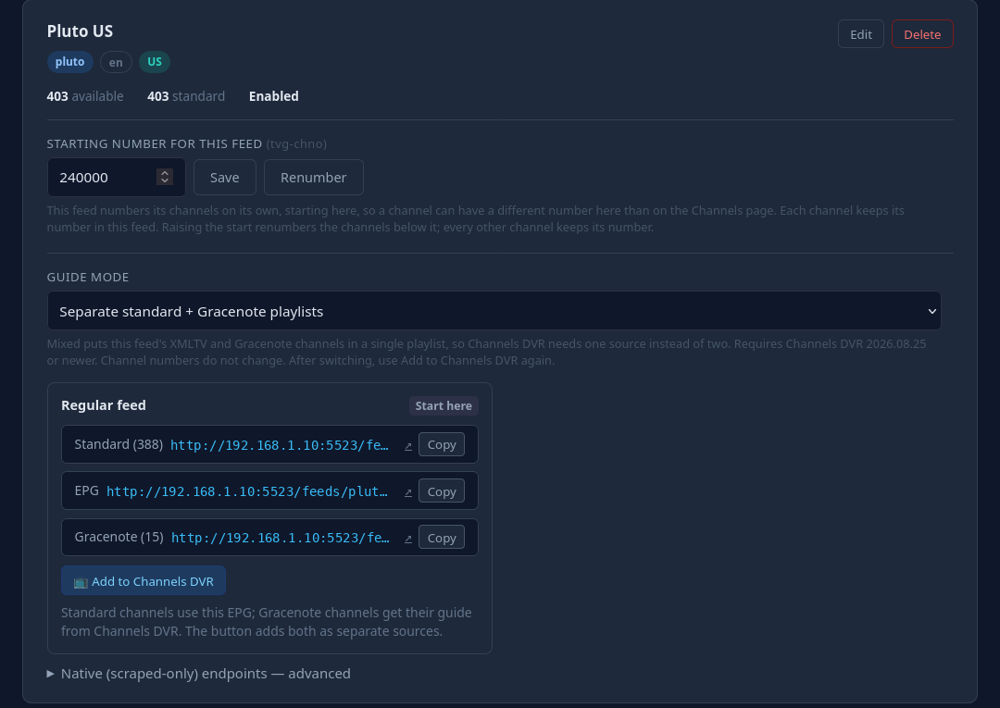

# radiotimes

A Fire TV app for watching live TV from a [tvtimes](https://github.com/issinoho/tvtimes)
server, using [tvdinner](https://github.com/issinoho/tvdinner) as its engine.

- **tvtimes** provides the channels, the guide, favourites and the watchlist,
  through the same export-token link tvdinner already understands
  (`tvtimess://host?token=…`).
- **tvdinner** runs unmodified inside the app (embedded CPython via
  [Chaquopy](https://chaquo.com/chaquopy/)). It handles playlist loading,
  XMLTV parsing and caching, now/next, and the tvtimes feeds.
- **The app** adds a 10-foot interface and plays streams with Media3/ExoPlayer.

## Quick Start

<!-- FRAMEWORK DRAFT: headings, flow and known-good commands are in place;
     TODO markers flag what still needs confirming. Screenshots go in
     docs/quickstart/ (01, 05, 09 and 10 captured; the rest are listed at the end). -->

This walks through building the whole stack from nothing on one Linux
machine running Docker with the Compose plugin. The core path uses
free-to-air UK channels from [Free-TV](https://github.com/Free-TV/IPTV),
so everything is legal to watch. Each later step is optional.

| Step | What you get | Needs |
|---|---|---|
| [1. tvtimes](#1-run-tvtimes) | your guide server: one line-up, one XMLTV guide | Docker + Compose on Linux |
| [2. Add Free-TV channels](#2-add-free-tv-channels) | legal free-to-air channels with a guide | step 1 |
| [3. tvdinner](#3-watch-on-the-desktop-with-tvdinner) | a desktop player for that line-up | a Linux desktop |
| [4. radiotimes](#4-optional-watch-on-a-fire-tv-with-radiotimes) *(optional)* | the same line-up on the TV | a Fire TV running Fire OS 7 or 8 |
| [5. FastChannels](#5-optional-add-pluto-tv-with-fastchannels) *(optional)* | Pluto TV's free ad-supported channels | step 1 |
| [6. HDHomeRun](#6-optional-add-an-hdhomerun-tuner) *(optional)* | your own aerial (DVB) channels | an HDHomeRun on the LAN |
| [7. Plex](#7-optional-add-your-plex-library) *(optional)* | your films and series alongside live TV | a Plex Media Server |



Solid arrows are the line-up and guide, refreshed on a schedule; dotted
ones are watch history reported back. Video never passes through
tvtimes: a player asks tvtimes for a channel and is redirected straight
to the stream (the broadcaster, FastChannels or the tuner). Plex sits
outside tvtimes altogether: each player talks to it directly, and
reports progress back to it. Steps 4 to 7 are optional.

The examples use `192.168.1.10` for the Docker host. Use your own.

### 1. Run tvtimes

```sh
mkdir ~/tvtimes && cd ~/tvtimes
curl -O https://raw.githubusercontent.com/issinoho/tvtimes/main/docker-compose.yml
curl -o .env https://raw.githubusercontent.com/issinoho/tvtimes/main/.env.example
```

Edit `.env`. On a LAN these three lines are all you need:

```sh
TVTIMES_PUBLIC_ORIGIN=http://192.168.1.10:8888   # exactly what the browser will show
TVTIMES_WEBAUTHN_RP_ID=localhost                  # keep for a bare-IP setup
POSTGRES_PASSWORD=...                             # e.g. the output of: openssl rand -hex 24
```

```sh
docker compose up -d
docker compose logs -f tvtimes     # the email verification link is printed here
```

Open `http://192.168.1.10:8888`, create your account, and click the
verification link from the log.



For HTTPS behind a reverse proxy, email, and backups, see the
[tvtimes self-hosting guide](https://github.com/issinoho/tvtimes/blob/main/docs/homelab.md).

### 2. Add Free-TV channels

Free-TV lists only channels that are free to watch, with official
streams. In tvtimes: **Sources → Add source → M3U**, and paste the UK
playlist:

```
https://raw.githubusercontent.com/Free-TV/IPTV/master/playlists/playlist_uk.m3u8
```

The playlist's header points at about a hundred worldwide guide files
at once, which neither tvtimes nor tvdinner reads as a guide. Attach
the UK one instead: open the new source's **EPG** panel and paste this
into **Attach XMLTV**:

```
https://iptv-epg.org/files/epg-gb.xml
```

Other countries follow the same pattern: `playlist_<country>.m3u8` in
[Free-TV's playlists](https://github.com/Free-TV/IPTV/tree/master/playlists),
`epg-<country code>.xml` on [iptv-epg.org](https://iptv-epg.org/).

<!-- TODO: id match checked 2026-11-17: 26 of the playlist's 55 tvg-ids are
     in epg-gb.xml. Most misses are BBC radio; others differ in name
     (BBCNews.uk vs BBCNewsChannel.uk, ITV1.uk vs regional ITV1 ids).
     Decide whether to say so, or whether tvtimes' name matching covers them
     (see the guide after the first refresh). -->

<!-- screenshot: docs/quickstart/02-add-m3u-source.png — Add source, M3U -->
<!-- screenshot: docs/quickstart/03-tvtimes-guide.png — guide grid filled in -->

Optionally, add a free [TMDB API key](https://www.themoviedb.org/settings/api)
under Settings for film artwork, cast and ratings.

### 3. Watch on the desktop with tvdinner

On Ubuntu 24.04 or newer:

```sh
sudo add-apt-repository ppa:issinoho/tvdinner
sudo apt install tvdinner
```

(Other distributions and Windows: see
[tvdinner's install section](https://github.com/issinoho/tvdinner#install).)

tvdinner can also play the Free-TV channels on its own, which is a
quick way to check the streams work before tvtimes is involved:

```sh
tvdinner https://raw.githubusercontent.com/Free-TV/IPTV/master/playlists/playlist_uk.m3u8 \
  --epg https://iptv-epg.org/files/epg-gb.xml
```

In tvtimes, turn the feeds on under **Settings → Export feeds** and press
**Open in tvdinner**, or copy the link it shows and run:

```sh
tvdinner 'tvtimes://192.168.1.10:8888?token=YOUR_TOKEN'
```

(This setup serves tvtimes over plain http, hence `tvtimes://`. Behind
an HTTPS reverse proxy the link starts `tvtimess://` instead.)

To keep the link rather than typing it each time, save it as a
bookmark. Run `tvdinner` with nothing after it to open the bookmarks
picker, press `a`, and fill in a name (say `tvtimes`), the link as the
URL, and optionally a device name, which is how this machine appears in
tvtimes' watch history. Or add it in one line:

```sh
tvdinner bookmarks add --name tvtimes \
  --url 'tvtimes://192.168.1.10:8888?token=YOUR_TOKEN' \
  --device-name 'Living room PC'
```

From then on `tvdinner` opens the picker, and `ENTER` on the row plays
your line-up. A tvtimes bookmark's **tvtimes** box starts ticked, so
tvdinner also reports what you watch, syncs your favourites and records
from your watchlist; `t` turns that off for one launch.

<!-- screenshot: docs/quickstart/04b-tvdinner-bookmarks.png — the bookmarks picker with the tvtimes row (token hidden) -->

<!-- screenshot: docs/quickstart/04-export-feeds.png — Settings → Export feeds (token blurred) -->


Treat the token like a password: it gives access to the whole line-up.
You can rotate it from the same panel.

### 4. (Optional) Watch on a Fire TV with radiotimes

Needs a Fire TV running Fire OS 7 or 8 (not Vega OS), and tvtimes 1.4.0
or newer for pairing.

1. Install radiotimes with the Downloader code **8716486** (full steps:
   [Install on a Fire TV Stick](#install-on-a-fire-tv-stick)).
2. Open it and choose **Pair with tvtimes**. It finds tvtimes on your
   network (or type `192.168.1.10:8888`) and shows a code.
3. In tvtimes, go to **Settings → Devices** and enter the code.

<!-- screenshot: docs/quickstart/06-radiotimes-pair.png — pairing code on the TV -->
<!-- screenshot: docs/quickstart/07-tvtimes-devices.png — Settings → Devices, approve -->
<!-- screenshot: docs/quickstart/08-radiotimes-channels.png — channel list -->

The wizard's next step is Plex: skip it for now, or see
[step 7](#7-optional-add-your-plex-library).

### 5. (Optional) Add Pluto TV with FastChannels

[FastChannels](https://github.com/kineticman/FastChannels) collects free
ad-supported (FAST) services such as Pluto TV and serves them as an M3U
playlist with an XMLTV guide. Run it as its own stack next to tvtimes:

```sh
mkdir ~/fastchannels && cd ~/fastchannels
cat > docker-compose.yml <<'YAML'
services:
  fastchannels:
    image: ghcr.io/kineticman/fastchannels:latest
    container_name: fastchannels
    ports:
      - 5523:5523
    volumes:
      - db_data:/data
      - adb_keys:/root/.android
    restart: unless-stopped

volumes:
  db_data:
  adb_keys:
YAML
docker compose up -d
```

Then open `http://192.168.1.10:5523/admin/`:

1. **Settings → FastChannels Server URL**: set `http://192.168.1.10:5523`.
   Stream links in the playlist use this address, so it must be one the
   Fire TV and desktop can reach, not `localhost`.
2. **Sources → Pluto TV**: switch it on (it ships off; no account is
   needed) and leave its region at the default, *United States (East)*.
   Let it scrape: channel counts climb on the dashboard over a few
   minutes.
3. **Sources → Pluto TV → Stream Audit**: this marks dead and
   DRM-protected channels and leaves them out of the feeds. Neither
   tvdinner nor radiotimes can play DRM channels.
4. **Feeds → New feed**: name it `Pluto US`, with **Sources: Pluto TV**
   and **Languages: en**. Its address uses the name: `/feeds/pluto-us/`.

Outside the US, Pluto may show its error slate instead of ad breaks. If
it does, open the Pluto TV source card and turn on **Route playlists
through FastChannels**, which fetches each playlist for the channel's
own region.

FastChannels also turns on several other free sources (The Roku
Channel, Samsung TV Plus, Plex, Xumo and more) out of the box. Leave
them: the `pluto-us` feed carries only Pluto TV, so that is all tvtimes
sees. Another feed can bring the others in later.





tvtimes blocks fetches from LAN addresses by default, so first allow
the FastChannels host. In tvtimes' `.env`:

```sh
TVTIMES_FETCH_ALLOWLIST=192.168.1.10
```

```sh
cd ~/tvtimes && docker compose up -d --force-recreate
```

Then add it in tvtimes as **Sources → Add source → M3U** with the
feed's *native* playlist (on the feed's card, under **Native
(scraped-only) endpoints**):

```
http://192.168.1.10:5523/feeds/pluto-us/native/m3u
```

The native playlist names its own guide in its header
(`/feeds/pluto-us/native/epg.xml`), so tvtimes picks up the guide without
anything attached.

<!-- screenshot: docs/quickstart/11-pluto-in-guide.png — Pluto channels in the tvtimes guide -->

Pluto's ad breaks can freeze a stream; tvdinner and radiotimes both
reconnect by themselves.

### 6. (Optional) Add an HDHomeRun tuner

This assumes the tuner is already set up and has scanned for channels
(in SiliconDust's own HDHomeRun app).

In tvtimes: **Sources → Add source → HDHomeRun**. tvtimes runs in
Docker's bridge network, which doesn't receive the tuner's discovery
broadcasts, so enter the tuner's LAN address instead of leaving it
blank:

```
http://192.168.1.50
```

tvtimes reads the tuner's channel list and adopts SiliconDust's guide
for those channels automatically, with nothing to attach; for DVB
channels that guide is free.

The tuner's channels then flow through the same export link to tvdinner
and radiotimes. If the tuner is on a different network from the
server, use the
[tvtimes connector](https://github.com/issinoho/tvtimes/blob/main/connector/README.md).
More detail: [tvtimes and HDHomeRun](https://issinoho.github.io/tvtimes/hdhomerun/).

<!-- screenshot: docs/quickstart/12-add-hdhomerun.png — Add source, HDHomeRun -->

### 7. (Optional) Add your Plex library

Plex isn't a tvtimes source: films and series come straight from your
Plex Media Server to each player, which browses the library, plays
from it, and reports progress back to Plex (so Resume works across
Plex's own apps too).

**In tvdinner**, a Plex server is a URL carrying your Plex token:

```sh
tvdinner 'plex://192.168.1.20:32400?X-Plex-Token=YOUR_PLEX_TOKEN'
```

To find the token, open any item in Plex Web, choose **Get Info → View
XML**, and copy the `X-Plex-Token=` value from the address bar
([Plex's instructions](https://support.plex.tv/articles/204059436-finding-an-authentication-token-x-plex-token/)).
Use `plexs://` if the server is only reachable over https. Save it as
a bookmark just as in [step 3](#3-watch-on-the-desktop-with-tvdinner),
and it sits alongside tvtimes in the picker:

```sh
tvdinner bookmarks add --name Plex \
  --url 'plex://192.168.1.20:32400?X-Plex-Token=YOUR_PLEX_TOKEN'
```

Like the tvtimes token, the Plex token is a password for your whole
library: it is stored as plain text in the bookmark file, and masked in
tvdinner's log.

**In radiotimes**, no token is needed. At the wizard's Plex step (or
later from **Settings → Link Plex account**), the TV shows a code;
open [plex.tv/link](https://plex.tv/link) on a phone or computer, sign
in, and enter it. Every server on that Plex account appears as its own
entry in the channel list's group rail, with On Deck, search and each
library.

<!-- screenshot: docs/quickstart/13-radiotimes-plex-code.png — the plex.tv/link code on the TV -->
<!-- screenshot: docs/quickstart/14-radiotimes-plex-library.png — a Plex library in radiotimes -->

<!-- Screenshots to capture (docs/quickstart/, tokens and addresses blurred):
     01 tvtimes sign-up · 02 Add M3U source · 03 tvtimes guide ·
     04 Export feeds · 04b tvdinner bookmarks · 05 tvdinner guide · 06 radiotimes pairing code ·
     07 tvtimes Devices · 08 radiotimes channel list · 09 FastChannels Pluto source ·
     10 FastChannels pluto feed · 11 Pluto in tvtimes guide · 12 Add HDHomeRun ·
     13 radiotimes Plex code · 14 radiotimes Plex library -->

## What it does

- **Setup:** a first-run wizard (Welcome → tvtimes → Plex → Ready).
  **Pair with tvtimes**: the TV finds tvtimes on your network (or you
  type its address), shows a code, and you enter it in tvtimes under
  Settings → Devices; the TV gets its own revocable feed token. Or scan
  the QR code on the TV (or open the address it shows on any phone or
  computer on your network) and paste your links there; or **Link
  Plex account** (enter the code at plex.tv/link: every server on the
  account is added, no tokens); or type them with the remote, or send
  them from a computer (below).
- **Channel list:** groups down the left, channels with logo and what's on
  now, details of the focused channel on the right. **★ Favourites** and
  **Watchlist** groups come from your tvtimes account (the watchlist as
  upcoming airings: "Today 21:00 · Title"). The guide shows at once from
  cache and refreshes in the background when it's over 6 hours old.
- **Live TV:** fullscreen with a now/next banner; ↑/↓ change channel, ◀
  goes back to the previous one. A dropped or frozen stream reconnects
  by itself (giving up after 10 minutes).
- **Guide:** ☰ opens a channels × time grid over the picture, which keeps
  playing in the corner; OK previews a channel, OK again shows the
  programme's full details.
- **Watch history in tvtimes:** what you watch live is reported back to
  your tvtimes account (as tvdinner's `--report-watch-state` does), so its
  web guide can show what's been watched. Only channels from your tvtimes
  link are sent, as start/stop times with the device's name.
- **Plex:** each Plex server is an entry in the group rail. Search, On
  Deck and libraries as poster grids (each library with **All**,
  **Recently Added** and **Recently Released** tabs), shows → seasons →
  episodes. OK on a movie or episode opens its details (summary, cast,
  director, genres, runtime, file quality, progress) with **Resume** /
  **Play from the start**. Plays the file directly with a seek bar, or,
  when the device can't decode it, a version your Plex server converts
  on the fly. **Skip intro** / **Skip credits** (or **Next episode**) at
  Plex's markers; audio and subtitle tracks, including Plex's sidecar
  subtitle files; **subtitles found online** through the Plex server's
  own search (☰ → Find subtitles online); progress reported back to
  Plex; the next episode starts when one ends.
- **Updates:** when a newer release is out, the channel list says so.
  **Settings → Check for updates** checks at once and installs it (the
  first time, Fire OS asks to allow radiotimes to install apps).

Phase 0 measured the engine on a Fire TV Stick (Fire OS 8, 32-bit ARM):
channel list 0.4 s, guide from cache 0.4 s, fresh guide ~15 s for an 11.6 MB
XMLTV feed, first frame 2.1 s.

### Roadmap

Done: engine probe → live TV → guide over the picture → Plex (details,
resume, skip intro/credits, tracks, search, transcode fallback) → setup
from a phone and plex.tv/link → signed releases and the Downloader code
→ tvtimes favourites, watchlist and watch reporting → find-and-approve
pairing (the tvtimes side shipped in tvtimes 1.4.0; discovery is a scan of the
TV's /24 for tvtimes' `/api/healthz`, since mDNS from tvtimes' Docker
bridge network wouldn't reach the LAN, with a typed address as the
fallback).

Next (each needs a change outside radiotimes):

- **"Send to Fire TV" from tvdinner** *(needs a tvdinner change)*:
  radiotimes advertises itself on the LAN; tvdinner's bookmarks screen
  pushes chosen tvtimes/Plex bookmarks to it in one keypress.
- **plex.tv linking in tvdinner itself**, so both apps share it.

Open issue: **phone setup when the phone can't reach the TV**. On the
author's phone the QR page fails with ERR_TOO_MANY_RETRIES. That phone
pings the TV but can't open a TCP connection to any device on the LAN
(a test page on a laptop failed the same way), so something on the
phone (a VPN or firewall app) blocks local connections; a laptop on the
same network opens the page fine. radiotimes can't fix that from the
TV; the tvtimes pairing above would avoid the LAN path entirely, and does once tvtimes has device pairing.

### Remote

| Where | Key | Does |
|---|---|---|
| Channel list | ↑ ↓ ← → | move between groups and channels |
| | OK | play |
| | ☰ (menu) | play the focused channel with the guide open |
| | Settings (foot of the groups) | see whether tvtimes and Plex are connected; pair again, link Plex, check for updates (links themselves under Advanced) |
| Player | ↑ / ↓, CH+ / CH− | next / previous channel in the group |
| | OK | show or hide what's on |
| | ◀ | back to the previous channel |
| | ☰ | guide, with the channel still playing in the corner |
| | Back | back to the list |
| Plex | OK | open a list, or a movie/episode's details |
| | OK on Resume / Play | play |
| | Back | up a level |
| Plex player | OK | controls and what's playing (again: pause) — or press the Skip / Next episode button when it shows |
| | ☰ / Info | full details of what's playing, picture size, subtitles on/off, find subtitles online |
| | ⏯ ⏩ ⏪ | play/pause, forward 30 s, back 10 s |
| Live TV and Plex | hold OK | picture size: Fit → Zoom → Stretch |
| | ↑ ↓ ← → | show the seek bar and controls |
| | ⏪ ⏩ | back 10 s / forward 30 s |
| | Back | hide controls, then leave (progress is saved to Plex) |
| Guide | ↑ ↓ ← → | move through channels and time (2 h at a time, 24 h ahead) |
| | OK | preview that channel in the corner |
| | OK again | full programme details |
| | OK in details | watch full screen |
| | Back / ☰ | details → guide → full screen |

## Install on a Fire TV Stick

**With the Downloader app (no computer needed):**

1. On the Fire TV: *Settings → My Fire TV → Developer options* → turn on
   **Install unknown apps** for Downloader (on Fire OS 8, tap *About →
   Fire TV Stick* seven times first to reveal Developer options).
2. Install **Downloader** (by AFTVnews) from the Amazon Appstore.
3. In Downloader, enter the code **8716486** (or the address it stands
   for, which always fetches the latest release:
   `https://github.com/issinoho/radiotimes/releases/latest/download/radiotimes.apk`).
4. Install, open radiotimes, and scan the QR code with your phone (or
   open the address shown under it on a computer).

**With adb (developers):** turn on **ADB debugging** too, note the Stick's
IP under *About → Network*, then from a computer on the same network:

```sh
adb connect <stick-ip>:5555        # accept the prompt on the TV
adb install -r radiotimes.apk      # a release, or app-debug.apk from a CI run
```

4. Open radiotimes from *Your Apps & Channels*. Typing the token with the
   remote is slow, so you can send your tvtimes link (Settings → Export
   feeds in tvtimes) from the computer instead, whether or not the app is
   already open:

   ```sh
   adb shell am start -n com.issinoho.radiotimes/.MainActivity \
     --es url 'tvtimess://your-host?token=YOUR_TOKEN' \
     --es plex 'plex://host:32400?X-Plex-Token=TOKEN plex://other:32400?X-Plex-Token=TOKEN'
   ```

   (`--es plex` is optional; give one or more Plex links separated by
   spaces. The token is the one Plex Web shows under *Get Info → View XML*.)

   For a bug report, `adb logcat -s radiotimes python.stderr` shows the
   guide timings (`guide |`) and stream start-up (`play |`).

Tokens are masked in everything the app logs or shows.

**Not supported:** Fire TV devices running Vega OS (e.g. the Fire TV Stick 4K
Select) don't run Android apps.

## Development

```sh
git clone --recurse-submodules https://github.com/issinoho/radiotimes
# bridge tests (no Android needed)
pip install requests==2.32.3 pytest
PYTHONPATH=app/src/main/python:vendor/tvdinner/src python -m pytest -q python-tests
# APK (needs the Android SDK, JDK 17 and Python 3.11 on PATH)
./gradlew assembleDebug
```

To try it without a real tvtimes, run `python3 tools/fake_tvtimes.py` and
point an Android TV emulator at it (instructions in the file).
